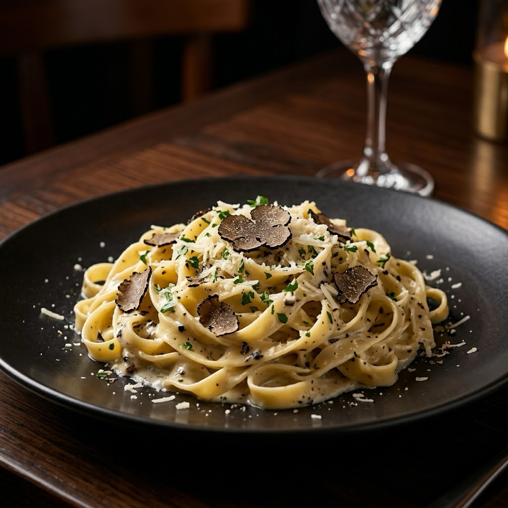

# NextDay Digital

Static marketing site plus eight complete, individually designed industry demos.

## Important: everything lives at the root

There is **no `assets` folder**. Every image is referenced as a plain filename:

```html

```

So the repository must look exactly like this — all files side by side, no parent folder:

```
index.html          base.css              restaurant.jpg
themes.html         theme-nextday.css     landscape.jpg
404.html            theme-restaurant.css  auto.jpg
restaurant.html     theme-landscape.css   bakery.jpg
landscape.html      theme-auto.css        fitness.jpg
auto.html           theme-bakery.css      salon.jpg
bakery.html         theme-fitness.css     contractor.jpg
fitness.html        theme-salon.css       professional.jpg
salon.html          theme-contractor.css
contractor.html     theme-professional.css
professional.html   app.js
                    robots.txt
                    sitemap.xml
```

If you drag the whole extracted folder into GitHub you will end up with
`nextdaydigital/index.html`, and nothing will load. Open the folder first, select
all the files inside it, then upload.

## Preview locally

```bash
python -m http.server 8777
```

Then open <http://localhost:8777>.

## How the theming works

`base.css` carries structure only — layout, grid, header, buttons, motion. It contains
no colours and no typefaces of its own; everything is a CSS custom property.

Each page then loads exactly one theme file which supplies the entire personality:

| Theme file | Demo | Display / UI type | Character |
| --- | --- | --- | --- |
| `theme-restaurant.css`   | Harbor & Vine       | Cormorant Garamond / Jost        | Editorial, square corners, hairline rules, antique gold |
| `theme-landscape.css`    | Field & Form        | Libre Baskerville / Inter        | Organic, 26–34px radii, sage and stone |
| `theme-auto.css`         | Gloss Garage        | Bebas Neue / Oswald + Barlow     | Matte black, lime, 2px corners, spec tables |
| `theme-bakery.css`       | Sunday Crumb        | Fraunces / Karla + Caveat        | Cream paper, blob shapes, handwritten accents |
| `theme-fitness.css`      | Northpoint Strength | Bebas Neue / Barlow Condensed    | Enormous condensed caps, signal red, zero radius |
| `theme-salon.css`        | Linden & Co         | Cinzel / Jost + Cormorant        | Wide tracking, blush and champagne, deep whitespace |
| `theme-contractor.css`   | Granite Ridge       | Montserrat 900 / Inter           | Heavy blocks, slate navy, safety orange, badge strip |
| `theme-professional.css` | Calloway & Reed     | Merriweather / Source Sans 3     | Conservative grid, navy and brass, ruled practice list |
| `theme-nextday.css`      | index + themes + 404| Manrope / DM Sans                | Deliberately quiet so the demos stand out |

No two demos share a typeface pairing, a corner radius, a button shape or a palette.
Each also has a **hand-tuned dark variant** rather than an inverted filter.

## Preview controls

Every demo carries a fixed dock with Light / Dark and a link back to the gallery.

- `?mode=dark` or `?mode=light` deep-links a demo into a specific mode.
- Pressing **L** or **D** switches mode from the keyboard.
- The choice is stored in `localStorage` and follows the visitor between pages.
- Gym and detailing default to dark; the other six default to light.

## Gallery filters

`themes.html` filters by industry and the filter is shareable:

```
themes.html?c=food   themes.html?c=home   themes.html?c=auto
themes.html?c=wellness   themes.html?c=pro
```

## Theme handoff

Every demo's closing call to action links to
`index.html?theme=<Business>#start`. The inquiry form reads that parameter, shows a
confirmation line and drops the theme name into the email draft, so you know which
design the prospect responded to before you reply.

## The inquiry form

Opens a pre-filled draft in the visitor's own mail app. Nothing is submitted, stored
or tracked. The in-progress draft is kept in `localStorage` so a mis-tap does not lose
it, and a hidden honeypot field catches naive bots.

## Accessibility and performance

- All animation is disabled under `prefers-reduced-motion: reduce`.
- Skip link, visible focus rings, `aria-expanded` / `aria-pressed` state, Escape closes the mobile menu.
- Four approved JPEGs per theme, compressed before deployment.
- A print stylesheet strips the chrome.

## Disclosure

All eight demo businesses are fictional. Names, staff, hours, addresses, telephone
numbers, prices and reviews are invented placeholders for layout purposes. They are
not real businesses, client projects or endorsements.


## Industry concept tabs and distinct layouts

Each demo now has an industry-specific secondary navigation bar. The tabs currently jump to sections on the same page, but their labels establish the future information architecture for menus, galleries, schedules, services, case studies and booking. Each theme restyles the component independently, and each theme also changes hero composition, section rhythm and content treatment so the pages do not feel like palette swaps.


## Final code review

- All 32 approved root-level JPEG filenames are used, with no other external image filenames.
- Each industry page uses only its own four-image family.
- Hero images load eagerly; supporting images are lazy-loaded and asynchronously decoded.
- Mobile heroes use `object-fit: cover`, focal positions and a stable viewport height so photos crop instead of stretch.
- Concept tabs are keyboard-accessible, scroll on phones and expose the active section through `aria-current`.
